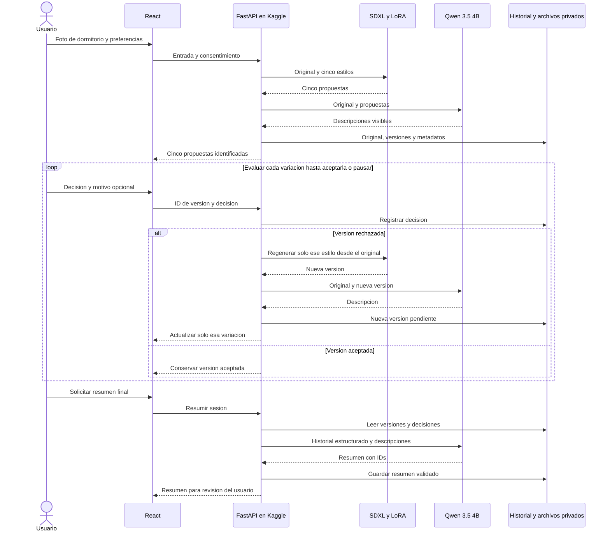
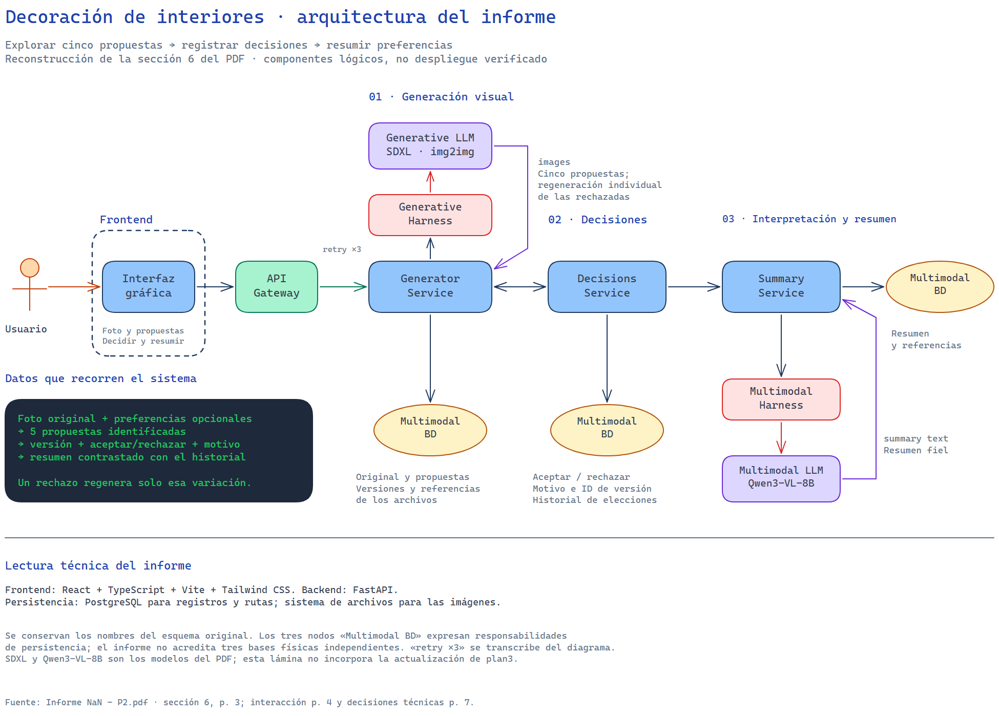
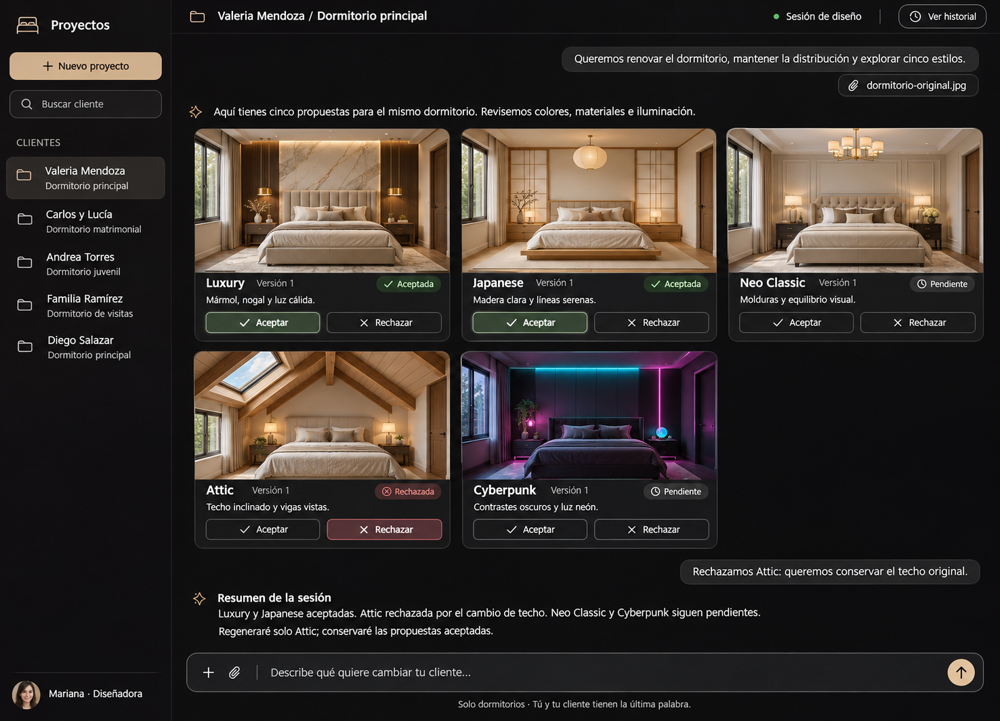

# Proyecto 2: plan de implementación para decoración de habitaciones

> **Para agentes implementadores:** aplicar `superpowers:executing-plans` por entregable. Las casillas indican trabajo pendiente; este documento no afirma que el sistema esté implementado o probado.

**Objetivo:** apoyar la comunicación de preferencias entre un cliente y un diseñador de interiores: recibir una fotografía de una **habitación (dormitorio)** y preferencias textuales opcionales, generar cinco propuestas visuales, permitir aceptar o rechazar cada versión, regenerar individualmente las rechazadas y producir un resumen fiel del historial de decisiones.

**Arquitectura:** React + Vite presenta la interfaz; FastAPI, ejecutado en Kaggle y accesible mediante ngrok, coordina SDXL img2img con cinco LoRA y Qwen3.5-VL-4B. PostgreSQL registra sesiones, versiones, decisiones y resúmenes; un almacenamiento privado de archivos conserva las fotografías y propuestas autorizadas. Kaggle es el entorno de inferencia de la PoC, con sesiones temporales; la persistencia del proyecto debe sobrevivir a su reinicio.

**Stack:** React + TypeScript + Vite + Tailwind CSS, FastAPI, PostgreSQL, SDXL Base 1.0, Diffusers, PEFT, PyTorch, Qwen multimodal de 4B y ngrok, sin depender de APIs de inferencia de pago. Se parte de la PoC [`poc/kaggle_back`](../../poc/kaggle_back/), no de un servidor A6000.

**Fuentes del proyecto:** [Informe NaN - P2.pdf](<G:/Mi unidad/2026/UTEC/2026-II/Plan IA/P2/Informe NaN - P2.pdf>), especialmente secciones 1 a 7 y 9; [plan2.md](plan2.md) como plantilla de estructura; [enunciado](../enunciado/); y el [notebook de la PoC](../../poc/kaggle_back/input/sdxl_qwen_fastapi_ngrok_lora.ipynb). La solicitud actual acota el informe a dormitorios y reemplaza sus estilos por Luxury, Japanese, Neo Classic, Attic y Cyberpunk. Las cifras del análisis de datos se atribuyen al informe y no a una nueva ejecución.

**Nombre del LLM y diferencia con la PoC:** el acuerdo del equipo se mantiene como **Qwen3.5-VL-4B**. El identificador oficial de la familia 3.5 con visión es [`Qwen/Qwen3.5-4B`](https://huggingface.co/Qwen/Qwen3.5-4B); ese será el objetivo de integración. El notebook actual carga `Qwen/Qwen3-VL-4B-Instruct` mediante `Qwen3VLForConditionalGeneration`, que es otro modelo. Jeffrey debe probar la migración, elegir la clase y dependencias compatibles y fijar la revisión; no basta con cambiar el nombre ni se presenta la migración como ejecutada.

## Alcance y criterios del enunciado

- **El proyecto se enfoca solamente en habitaciones entendidas como dormitorios.** No incluye salas, cocinas, baños, oficinas, comedores, exteriores ni otros espacios. La entrada, los prompts, la selección de datos, la evaluación y la demo deben respetar este límite.
- La entrada es una fotografía de un dormitorio, con preferencias opcionales sobre colores, materiales, iluminación o elementos que el usuario desea conservar. Si el texto está vacío, se emplean los prompts del catálogo.
- La salida inicial contiene **exactamente cinco imágenes estáticas** del mismo dormitorio: Luxury, Japanese, Neo Classic, Attic y Cyberpunk. Se utiliza SDXL como única base generativa y una LoRA compatible por variación.
- Conservar distribución, perspectiva, cama, puertas, ventanas y geometría es un **objetivo por evaluar**, no una garantía. Las propuestas son referencias de decoración y requieren revisión del diseñador; no son planos ni certificaciones de viabilidad constructiva.
- El usuario acepta o rechaza cada versión y puede indicar motivos. Un rechazo conserva su registro y dispara una regeneración de **esa variación únicamente**, manteniendo las aceptadas. La nueva versión comienza pendiente; se repite hasta aceptación o hasta que el usuario pause o abandone la sesión.
- Qwen describe lo visible y resume aceptaciones y rechazos por ID de versión. Los motivos del usuario se distinguen de las observaciones del modelo. El resumen final requiere cinco versiones vigentes aceptadas e incluye también los rechazos históricos relevantes.
- Se conserva evidencia autorizada de la fotografía original, propuestas, versiones, decisiones y resumen, retomando el informe original. Esto reemplaza la política de imágenes solo temporales de `plan2`; exige consentimiento, acceso privado y eliminación.
- Se deben justificar datos y preprocesamiento, medir calidad, diversidad, conservación espacial, coherencia del resumen y usabilidad, e incluir limitaciones y ética. La evaluación de uso contempla **10 usuarios**, con resultados reales y tamaño efectivo declarado.
- La entrega incluye código reproducible, informe, PPT y demostración en vivo o video según el enunciado. Verificar en el enunciado vigente el límite de páginas y la modalidad; no confundir las nueve páginas del informe de referencia con un permiso de extensión.

## Riesgos que deben cubrir las pruebas

1. Se carga una sala u otro espacio: pedir una foto de dormitorio antes de generar. Si la identificación es incierta, solicitar confirmación; no presentar la clasificación visual como infalible.
2. Una LoRA no es compatible o queda activa al cambiar de estilo: bloquear esa configuración y verificar que cada salida use únicamente su adaptador. Attic podría modificar techos; registrar esa alteración como pérdida de conservación espacial.
3. Falla la cuarta generación o una regeneración: no declarar completo un lote parcial ni perder las versiones aceptadas. Conservar la rechazada y permitir reintentar sin duplicar versiones o decisiones.
4. Se reinicia Kaggle o cambia el túnel: mostrar desconexión, conservar el historial externo y recuperar el acceso tras actualizar la URL. Ningún usuario debe acceder a imágenes o decisiones de otro.
5. Una decisión cambia, aparece una versión nueva o Qwen invierte decisiones: invalidar el resumen anterior, contrastar IDs y texto con el registro y evitar motivos inventados.

## Flujo del sistema

Se mantiene el flujo de colaboración humano–IA del informe y se adapta a un único backend FastAPI en Kaggle. Los servicios del diagrama original son responsabilidades lógicas; no se requiere desplegar un microservicio por cada caja. SDXL genera secuencialmente; Qwen analiza por pares si lo exige la memoria. [Fuente Mermaid](diagramas/plan3-flujo.mmd).



La sesión incompleta puede pausarse sin inventar aceptaciones. Un resumen de avance, si se ofrece, debe rotularse como parcial. Tras recargar la página, recuperar las imágenes autorizadas y decisiones desde el almacenamiento privado, no desde la RAM del notebook.

## Cinco estilos y modelos candidatos

Se utilizan las **cinco LoRA gratuitas indicadas por el equipo**, sin entrenamiento desde cero ni APIs de inferencia de pago. La consulta de la API pública de Civitai del **11 de noviembre de 2026** identifica las versiones enlazadas como `LORA`, base `SDXL 1.0`, con los siguientes activadores. Esto verifica sus metadatos, no la descarga gratuita efectiva, su rendimiento ni todos los permisos de uso.

| ID  | Variación   | LoRA y versión seleccionada                                                                                                                     | Base declarada | Activador                    |
| --- | ----------- | ----------------------------------------------------------------------------------------------------------------------------------------------- | -------------- | ---------------------------- |
| 1   | Luxury      | [JJ's Interior - Luxury Bedroom](https://civitai.com/models/1784893/jjs-interior-luxury-bedroom?modelVersionId=354150), XL 1.0 / `354150`       | SDXL 1.0       | `Luxury Bedroom`             |
| 2   | Japanese    | [JJ's Japanese Interior](https://civitai.com/models/250951/jjs-japanese-interior?modelVersionId=371394), XL v1.0 / `371394`                     | SDXL 1.0       | `Japanese Interior`          |
| 3   | Neo Classic | [JJ's Interior style - Neo Classic](https://civitai.com/models/351042/jjs-interior-style-neo-classic?modelVersionId=392637), XL v1.0 / `392637` | SDXL 1.0       | `Neo Classic`                |
| 4   | Attic       | [Attic bedroom](https://civitai.com/models/2395230/attic-bedroom?modelVersionId=2693144), v1.0 / `2693144`                                      | SDXL 1.0       | `Attic b3dr00m`              |
| 5   | Cyberpunk   | [Cyberpunk bedroom interior](https://civitai.com/models/2209481/cyberpunk-bedroom-interior?modelVersionId=2487610), v1.0 / `2487610`            | SDXL 1.0       | `Cyberpunk bedroom 1nt3r10r` |

Catálogo fijo: no sustituir estas versiones por variantes SD 1.5 o Flux. Antes de incorporarlas, Fabryzzio registra acceso gratuito real, licencia, condiciones del autor, archivo, hash, activador, escala y versión; gratuidad no significa licencia irrestricta. Japanese y Neo Classic describen interiores en general, pero sus prompts y pruebas aquí deben generar **solo dormitorios**. Attic se trata como variación visual de dormitorio abuhardillado, midiendo especialmente cambios estructurales no deseados.

**Punto de partida real de la PoC:** `StableDiffusionXLImg2ImgPipeline`, base `stabilityai/stable-diffusion-xl-base-1.0`, revisión `462165984030d82259a11f4367a4eed129e94a7b`; SDXL en `cuda:0` y el Qwen actual en `cuda:1`, con dos T4. Carga un solo archivo, `JJsLuxuryBedroom_XL.safetensors`, con escala `0.8`; usa `strength=0.75`, 35 pasos, `guidance_scale=7.5` y lienzo 1024 × 768 o 768 × 1024. Son parámetros presentes en código, no parámetros óptimos para preservar habitaciones.

La PoC expone `GET /health` y `POST /generate` multipart con `image` y `prompt`; responde una sola imagen Base64 y una descripción. Incluye un bloqueo de inferencia, límite de lectura de 10 MiB y comprobación de 25 megapíxeles. El notebook local no contiene celdas ejecutadas; `response.json` aporta un ejemplo de respuesta, pero no demuestra cinco estilos, regeneración, persistencia, resumen o rendimiento. Las descripciones del archivo presentan problemas de codificación que deben revisarse en el recorrido completo.

Se propone reutilizar la base SDXL e intercambiar un adaptador por vez. Comparar al menos dos valores de `strength` y dos escalas de LoRA durante desarrollo; fijar semilla y resto de parámetros para interpretar las diferencias. Regenerar desde la **foto original** más el estilo y preferencias vigentes para reducir deriva acumulada. Explorar ControlNet compatible con SDXL solo si las pruebas muestran que hace falta preservar mejor la estructura.

## Investigación de datasets

Se retoma `interior_style_dataset` de hammer888 como **fuente de referencias analizada en el informe**, sujeta a permisos. El informe reporta 7.233 imágenes: moderno 4.161, nórdico 1.583, japonés 864, lujo 277, industrial 238 y Country 110; todas JPEG RGB decodificables, sin duplicados exactos, con medianas de 1.500 × 1.000 píxeles. Reporta 105 pares potencialmente similares que involucran 193 imágenes y una muestra visual de 120 con distintos ambientes y contenido exterior.

Esos números describen el conjunto original: **no son cantidades de dormitorios**, ni validan el nuevo catálogo de cinco estilos. La fuente no etiqueta el tipo de habitación y, según el informe, no especifica licencia ni validación académica de las etiquetas. No se usarán las categorías moderno/nórdico/industrial como salidas del nuevo sistema ni se inventarán etiquetas Attic, Neo Classic o Cyberpunk para esas imágenes.

| Fuente                              | Uso propuesto                                                                                 | Verificación necesaria                                                                                               |
| ----------------------------------- | --------------------------------------------------------------------------------------------- | -------------------------------------------------------------------------------------------------------------------- |
| Dataset analizado en el informe     | Seleccionar manualmente fotografías de dormitorios como referencias o entradas de desarrollo. | Resolver permisos; descartar otros espacios, detalles sin contexto y exteriores; revisar similares antes de dividir. |
| Fotografías propias autorizadas     | Evaluar entradas cercanas al caso real de uso y probar la herramienta.                        | Consentimiento, ausencia de información personal visible y separación por dormitorio.                                |
| Ejemplos de los autores de las LoRA | Entender activadores y apariencia esperada.                                                   | Permisos de uso/divulgación; no tratarlos como evaluación independiente del modelo.                                  |

No se requiere entrenar ni ajustar pesos con este conjunto; se evalúan modelos preentrenados. Si los permisos del dataset no se aclaran, trabajar con fotografías propias autorizadas y documentar la limitación. La cantidad final de dormitorios disponibles se obtiene después del filtrado, no del total original.

### Cómo preparar un conjunto propio pequeño

1. Invitar participantes adultos con autorización para fotografiar el dormitorio. Explicar procesamiento, almacenamiento privado, acceso, plazo de retención y retiro; solicitar permiso separado para mostrar imágenes en informe, PPT o demo.
2. Meta técnica propuesta: **20 dormitorios distintos**, 10 para desarrollo y 10 reservados para evaluación. Si no se alcanza, informar el tamaño real y ajustar el alcance exploratorio. Los **10 usuarios de usabilidad** son una muestra de personas distinta de la unidad de análisis visual; no suponer que cada usuario aporta una foto.
3. Seleccionar vistas con cama, paredes y aberturas visibles, variando iluminación, perspectiva, dimensiones y mobiliario. Excluir otros espacios, personas, documentos, pantallas y fotografías personales reconocibles; recortar u ocultar esos elementos antes de subir la imagen.
4. Crear un manifiesto privado con `sample_id`, `room_id` seudónimo, origen, autorización, permiso de divulgación, partición, dimensiones y observaciones. Mantener los consentimientos por separado y las imágenes fuera de Git.
5. Dividir por **dormitorio**, agrupando fotos del mismo espacio y duplicados o similares antes de ajustar parámetros. Revisar EXIF, formatos, resolución, desenfoque y cobertura espacial; evitar el mismo dormitorio en desarrollo y evaluación.
6. Reutilizar corrección EXIF, RGB y redimensionamiento proporcional del informe, adaptando dimensiones a SDXL. Documentar bordes y recortes: la PoC usa `ImageOps.pad`, que puede recortar si las proporciones difieren. Comprobar el efecto en puertas, ventanas y cama. Dejar la normalización al procesador de la pipeline para evitar aplicarla dos veces.

## Contrato de datos y persistencia

**En PostgreSQL:** usuarios o participantes seudónimos, sesiones, prompt opcional y prompts efectivos, catálogo y versiones de modelos, semillas, parámetros, descripciones, decisiones por versión, resúmenes y referencias privadas a archivos.

**En almacenamiento privado de archivos:** fotografía original y cada versión generada que forme parte de la evidencia autorizada. PostgreSQL guarda rutas o claves y metadatos, no Base64. No usar URLs públicas permanentes ni incluir imágenes, credenciales o consentimientos en Git o logs. Definir retención y borrado de registros y archivos asociados, incluidos respaldos según su política.

**Kaggle:** `/kaggle/input` aporta pesos; caché y espacio de trabajo sirven para ejecución temporal. Ni la RAM ni `/kaggle/working` sustituyen la persistencia duradera del proyecto. Ian debe configurar una base PostgreSQL y un almacenamiento privado accesibles desde Kaggle, fuera del ciclo de vida del notebook y dentro del presupuesto gratuito, antes de las pruebas de usuarios. Guardar credenciales en Secrets. No publicar automáticamente fotografías como outputs o datasets de Kaggle.

Propuesta mínima de tablas:

- `users`: `id`, alias y credencial protegida; acceso individual al historial.
- `sessions`: `id`, `user_id`, clave de la foto original, preferencias, consentimiento, fecha y estado (`generating`, `ready`, `failed`, `completed`, `paused`).
- `variations`: `id`, `session_id`, `position` de 1 a 5, `style` y `current_version_id`; posición única por sesión.
- `image_versions`: `id`, `variation_id`, número de versión, clave privada de imagen, prompt efectivo, semilla, parámetros, revisiones de base/LoRA/LLM, descripción y fecha; versiones anteriores inmutables.
- `decisions`: `id`, `image_version_id`, `accepted` o `rejected`, motivo opcional y fecha. Conservar eventos si cambia una decisión; ausencia de decisión vigente significa pendiente.
- `summaries`: `session_id`, revisión del historial, IDs aceptados/rechazados y texto validado; nueva decisión o versión invalida su vigencia.

Toda lectura y escritura verifica el propietario de la sesión. El lote inicial solo pasa a `ready` con cinco resultados válidos y estilos únicos. La sesión solo pasa a `completed` cuando las cinco versiones actuales están aceptadas. Guardar una nueva versión y actualizar su puntero como una sola operación lógica; si falla el guardado, no reemplazar la versión vigente y limpiar el archivo huérfano.

### API propuesta

| Operación                                                                  | Contrato                                                                                                                                                                                                          |
| -------------------------------------------------------------------------- | ----------------------------------------------------------------------------------------------------------------------------------------------------------------------------------------------------------------- |
| `GET /health`                                                              | Compatibilidad con la PoC; informar disponibilidad real de modelos y servicios necesarios.                                                                                                                        |
| `POST /generate`                                                           | Mantener temporalmente el contrato de una imagen para pruebas de Fabryzzio y Jeffrey; no presentarlo como el flujo final de cinco opciones.                                                                       |
| `POST /api/auth/register`, `POST /api/auth/login`, `POST /api/auth/logout` | Acceso individual con contraseñas protegidas y sesión segura.                                                                                                                                                     |
| `POST /api/generations`                                                    | Recibe foto de dormitorio, preferencias opcionales y consentimiento; crea sesión y cinco variaciones con IDs, versiones, imágenes privadas y descripciones. Devuelve error explícito si el lote queda incompleto. |
| `PUT /api/generations/{id}/decisions/{version_id}`                         | Registra decisión y motivo opcional; comprueba versión vigente y propietario. Aceptar conserva la imagen; rechazar agenda solo su regeneración. Repetir una petición no debe duplicarla.                          |
| `POST /api/generations/{id}/variations/{position}/retry`                   | Reintenta una regeneración fallida del estilo rechazado; conserva versiones y decisiones anteriores. No reemplaza una opción aceptada.                                                                            |
| `POST /api/generations/{id}/summary`                                       | Exige cinco versiones actuales aceptadas; resume también el historial de rechazos y valida IDs, decisiones y revisión.                                                                                            |
| `GET /api/generations`, `GET /api/generations/{id}`                        | Historial propio con versiones, decisiones y acceso autenticado a imágenes privadas.                                                                                                                              |
| `DELETE /api/generations/{id}`                                             | Elimina sesión, imágenes y registros asociados conforme a la política de retención.                                                                                                                               |

Partir de multipart para aprovechar la PoC. Aplicar límites de cuerpo antes del parser, además de validar tamaño decodificado, píxeles y contenido real; cerrar y limpiar archivos temporales de `UploadFile`. Validar JPEG, PNG o WebP y controlar concurrencia y tiempos de espera. Inicialmente una inferencia a la vez; responder con estado recuperable a solicitudes concurrentes. Si frontend y túnel tienen distinto origen, configurar CORS para el origen concreto o un proxy; `NGROK_AUTHTOKEN` autentica al agente de túnel, **no a los usuarios de la API**.

### Función de Qwen

1. Con Qwen3.5-VL-4B (`Qwen/Qwen3.5-4B` como identificador objetivo), analizar original y propuesta: cama, distribución visible, aberturas, iluminación, colores, materiales y cambios observables. Procesar pares secuencialmente si la VRAM lo requiere; no afirmar medidas, seguridad estructural ni elementos ocultos.
2. Comprobar el alcance de dormitorio y marcar incertidumbre. Tratar texto de imágenes, preferencias y motivos como datos; nunca como instrucciones para modificar el registro o saltar validaciones.
3. Resumir desde el historial estructurado: versiones aceptadas actuales y rechazos anteriores. Vincular cada afirmación a su ID; si el usuario no indicó motivo, no inventarlo a partir de la interpretación visual.
4. Exigir JSON con `accepted_version_ids`, `rejected_version_ids` y `summary`. Contrastar listas con las decisiones vigentes de **cada versión evaluada**, excluyendo versiones pendientes; revisar además contradicciones del texto. Las aceptadas y rechazadas se refieren a versiones, no solo a las cinco posiciones.
5. Si la salida es inválida, reintentar una vez y después mostrar error sin perder decisiones. Guardar la revisión del historial usada; descartar la respuesta si cambió durante la inferencia. Permitir al usuario revisar el resumen final.

## Organización propuesta

```text
backend/kaggle/sdxl_qwen_fastapi_ngrok_lora.ipynb # Arranque en Kaggle y modelos
backend/kaggle/kernel-metadata.json               # Configuración del kernel e inputs
backend/app/main.py                               # API, configuración y ciclo de vida
backend/app/generation.py                         # SDXL, catálogo y regeneración
backend/app/vision.py                             # Qwen y resumen validado
backend/app/storage.py                            # PostgreSQL y archivos privados
backend/app/auth.py                               # Acceso e identidad de sesión
backend/app/schemas.py                            # Contratos y versiones
backend/tests/                                    # Pruebas de integración y contratos
frontend/                                         # UI de dormitorios, galería e historial
data/manifest.example.csv                         # Esquema sin datos privados
notebooks/01_bedroom_data.ipynb                   # Filtrado de dormitorios y exploración
scripts/evaluate.py                               # Métricas y agregados
report/informe.md                                 # Informe actualizado
report/presentacion.pptx                          # PPT de resultados y demostración
README.md                                         # Arranque, versiones y límites
```

La aplicación se organizará en dos carpetas en la raíz del repositorio: `frontend/` y `backend/`. La PoC existente en `poc/kaggle_back/` es el punto de partida: adaptar su notebook y sus metadatos a `backend/kaggle/`, y extraer las funciones a `backend/app/`, manteniendo el notebook como lanzador. Las rutas de esta organización son propuestas, no archivos ya trasladados. `poc/khipu_front` es una PoC de chat y no acredita una interfaz de decoración. No guardar pesos nuevos ni imágenes privadas en Git; fijar dependencias después de probar SDXL y Qwen3.5 en Kaggle.

## Entregables y cronograma propuesto

Plazo disponible: **7 días**. Los entregables se trabajan en paralelo entre los cuatro responsables, reutilizando la PoC y acordando los contratos de integración el día 1. Las pruebas siguientes son trabajo propuesto; el cronograma no acredita ejecuciones realizadas. La búsqueda de usuarios y los borradores del informe y la PPT comienzan desde el primer día.

| Día | Trabajo principal y responsables | Hito de cierre |
| --- | --- | --- |
| 1 | Fabryzzio verifica SDXL y las cinco LoRA; Jeffrey prueba Qwen3.5; Ian prepara Kaggle, persistencia y contratos; Bianca define el recorrido y las pantallas. Todo el equipo inicia selección de dormitorios, reclutamiento y borradores. | Factibilidad inicial documentada, contrato compartido y agenda de usuarios en preparación. |
| 2 | Fabryzzio ajusta las cinco variaciones; Jeffrey desarrolla descripciones y resumen; Ian implementa API e historial; Bianca construye la interfaz contra el contrato acordado. El equipo cierra datos, particiones y protocolo. | Muestra de dormitorios reservada y componentes principales en desarrollo. |
| 3 | Fabryzzio cierra generación y regeneración individual; Jeffrey verifica decisiones y JSON; Ian y Bianca conectan backend y frontend. | Primer recorrido integrado: foto, cinco estilos, rechazo y nueva versión. |
| 4 | Integración completa de Qwen, persistencia, acceso e historial; pruebas de fallos y recorrido interno con todo el equipo. Confirmar las 10 citas y preparar ejemplos autorizados. | Flujo completo listo para usuarios; parámetros congelados antes de evaluar. |
| 5 | Ejecutar evaluación técnica con la configuración congelada y primera tanda de pruebas con usuarios. Repartir las sesiones entre el equipo, respetando la capacidad de inferencia de Kaggle. | Métricas y observaciones registradas; primera tanda de usuarios completada. |
| 6 | Completar las pruebas hasta llegar a 10 usuarios, consolidar resultados y corregir bloqueos. Todo el equipo incorpora evidencia al informe y la PPT. | Evaluación cerrada con tamaño efectivo declarado e informe/PPT con resultados. |
| 7 | Verificar correcciones, revisar informe y PPT, comprobar reproducción y ensayar o grabar la demostración. | Entrega final revisada y demo preparada. |

**Dependencias y margen:** reservar el día 7 para revisión y entrega. No iniciar las pruebas de usuarios antes de comprobar el flujo completo del día 4. Si una corrección posterior cambia el comportamiento evaluado, repetir los casos afectados e identificar la versión utilizada. Priorizar SDXL con las cinco LoRA, Qwen, regeneración individual y evidencia trazable; las exploraciones opcionales, como ControlNet, solo se realizan si el flujo principal ya está listo.

### Entregable 1: factibilidad y selección de modelos — día 1

**División:** pruebas con el modelo generativo (**Fabryzzio**); pruebas con el LLM (**Jeffrey**); preparación de Kaggle (**Ian**).

- [ ] Ian confirma Internet, dos T4, inputs privados, secretos, acceso al almacenamiento y funcionamiento del túnel; registra límites efectivos de la sesión y recuperación tras reinicio.
- [ ] Fabryzzio verifica las cinco versiones LoRA de la tabla, descarga gratuita y permisos; registra hashes, activadores y escalas. Contrasta el archivo Luxury local con la versión elegida.
- [ ] Fabryzzio genera una propuesta real por estilo desde un dormitorio autorizado; registra parámetros, tiempo, pico de VRAM, fallos y cambios espaciales. Verifica que no se acumulen adaptadores entre estilos.
- [ ] Jeffrey prueba `Qwen/Qwen3.5-4B` con imagen y texto, adapta la carga y fija versiones compatibles; compara descripción con detalles visibles y obtiene un JSON de decisiones válido. Distingue esta ejecución de la del Qwen3-VL de la PoC.
- [ ] Ian mide con ambos responsables si SDXL y Qwen pueden permanecer uno por T4; si no, documenta carga por fases o cuantización probada, sin cambiar silenciosamente el modelo acordado.

**Cierre:** cinco rutas SDXL cargadas y probadas, más inferencia real del Qwen3.5 objetivo en Kaggle; recursos y limitaciones registrados. Una ruta fallida permanece pendiente.

### Entregable 2: dataset y análisis exploratorio — días 1 y 2

**División:** equipo completo; Fabryzzio coordina criterios visuales y Jeffrey revisa el protocolo de evaluación. Comienza en paralelo la **búsqueda de 10 usuarios para probar la herramienta**, a cargo de todo el equipo.

- [ ] Resolver permisos de la fuente del informe o elegir fotos propias autorizadas; filtrar exclusivamente dormitorios y revisar similares. Informar el recuento resultante sin reutilizar las cifras globales como si fueran dormitorios.
- [ ] Crear manifiesto y particiones por `room_id`; reservar las entradas de evaluación antes de ajustar prompts o parámetros.
- [ ] Documentar dimensiones, formatos, iluminación, perspectivas, calidad y limitaciones en `notebooks/01_bedroom_data.ipynb`; verificar preprocesamiento de SDXL y ausencia de recortes importantes.
- [ ] Reclutar 10 usuarios adultos, explicar la prueba, obtener consentimiento y agendar sesiones; preparar tarea, rúbrica y encuesta breve. Registrar participación real y permiso de divulgación por separado.

**Cierre:** muestra autorizada de dormitorios, particiones y preprocesamiento documentados, protocolo listo y reclutamiento trazable; las métricas antiguas del dataset quedan identificadas como antecedentes.

### Entregable 3: generador img2img — días 2 y 3

**División:** **pruebas con el modelo generativo — Fabryzzio**; integración de API con Ian.

**Archivos:** `backend/app/generation.py`, `backend/tests/test_generation.py` y `backend/kaggle/sdxl_qwen_fastapi_ngrok_lora.ipynb`.

- [ ] Definir `generate_five(original, preferences) -> list[VariationResult]` y `regenerate_one(original, style, preferences, previous_version_id) -> VariationResult`; cada resultado incluye posición, estilo, bytes, prompt, semilla, parámetros y versiones de pesos.
- [ ] Implementar los cinco adaptadores sobre SDXL, activando solo uno por llamada; incluir activador, contexto explícito de dormitorio y preferencias opcionales. Generar secuencialmente.
- [ ] Comparar `strength` y escala LoRA en desarrollo con semillas controladas; seleccionar parámetros antes de evaluar. Medir preservación de cama, paredes, ventanas, puertas y techo, especialmente con Attic.
- [ ] Verificar lote incompleto, IDs repetidos, LoRA incorrecta y fallo de GPU. Comprobar que regenerar una rechazada deja idénticas las cuatro propuestas restantes y sus metadatos; ejecutar además un lote real de cinco estilos en Kaggle.

**Cierre:** cinco propuestas reales por dormitorio y regeneración individual con trazabilidad. Separar pruebas con dobles de la evidencia generada por SDXL.

### Entregable 4: API, usuarios e historial — días 2 a 4

**División:** **desarrollo del Backend en Kaggle — Ian**, con contratos de generación y LLM revisados por Fabryzzio y Jeffrey.

**Archivos:** `backend/app/main.py`, `backend/app/auth.py`, `backend/app/schemas.py`, `backend/app/storage.py`, migraciones y pruebas en `backend/tests/`.

**Referencia de arquitectura:** [diagrama editable en Excalidraw](../excalidraw/arquitectura-informe-p2.excalidraw), reconstruido a partir del PDF original. Sus servicios de generación, decisiones y resumen orientan la separación de responsabilidades del backend; en este plan se integran en FastAPI sobre Kaggle. El diagrama conserva el Qwen3-VL-8B del informe: la implementación debe usar el Qwen3.5 de 4B definido en este plan.



- [ ] Extender la PoC de `/generate` al contrato de sesiones y cinco variaciones; conservar la ruta simple para pruebas y documentar la diferencia.
- [ ] Implementar PostgreSQL, almacenamiento privado externo a Kaggle y acceso por propietario. Registrar original, versiones, decisiones y resumen; verificar recuperación tras reinicio del notebook.
- [ ] Implementar rechazo con regeneración individual, idempotencia, versiones pendientes e invalidación de resúmenes; si falla una regeneración o su persistencia, conservar el estado anterior y permitir reintento.
- [ ] Aplicar límites de carga, limpieza de temporales, control de GPU y errores recuperables. Configurar secretos, autenticación, CORS o proxy y URL de túnel mediante configuración, sin exponer credenciales al frontend.
- [ ] Verificar aislamiento entre usuarios, borrado de imágenes/registros, fallo de persistencia, versión obsoleta, rechazo repetido, pérdida de túnel y reinicio de Kaggle.

**Cierre:** backend reproducible en Kaggle, persistencia privada recuperable, regeneración trazable y contratos utilizables por Bianca.

### Entregable 5: interfaz React + Vite — días 2 a 4

**División:** **desarrollo del Frontend — Bianca**, con integración de backend coordinada con Ian.

**Avance local, 13 de noviembre de 2026:** la rama `feat/frontend-dormitorios` incorpora [`frontend/`](../../frontend/README.md) con React, TypeScript, Vite y Tailwind: proyectos por cliente, carga y validación de foto, cinco tarjetas, decisiones versionadas, regeneración individual simulada, pausa, historial en IndexedDB y resumen determinista de demostración. Sigue el mockup y funciona sin backend. Las imágenes son ejemplos locales; una regeneración reutiliza el mismo ejemplo. El acceso no autentica usuarios y el almacenamiento no ofrece aislamiento entre personas del mismo perfil del navegador. Las casillas siguientes siguen describiendo la entrega integrada: la API real, la inferencia, las cuentas privadas y la persistencia externa continúan pendientes.

**Archivos:** `frontend/src/` y pruebas del recorrido de usuario.

**Referencia visual del frontend:** mockup generado con ImageGen para el diseñador de interiores y sus clientes. Presenta un chat con proyectos por cliente en el panel izquierdo, cinco propuestas de dormitorio con botones de aceptar/rechazar, feedback del cliente, respuestas del modelo de lenguaje y una barra inferior para ingresar el prompt. Los nombres y resultados son ilustrativos; la imagen guía el diseño y no acredita una interfaz implementada. [Prompt del mockup](../design/chat-dormitorios-v1-prompt.md).



- [ ] Crear acceso, carga de foto, consentimiento y preferencias opcionales. Mostrar de forma destacada **«Solo habitaciones / dormitorios»** y un ejemplo de entrada apropiada.
- [ ] Presentar original y cinco tarjetas con nombre del estilo, ID/versión visible para trazabilidad, descripción, aceptación, rechazo y motivo opcional; toda versión nueva comienza pendiente.
- [ ] Al rechazar, indicar que se regenera solo esa propuesta. Mantener aceptadas visibles, mostrar progreso por tarjeta y permitir reintento si falla. Evitar botones que registren dos veces la misma acción.
- [ ] Permitir pausar, recuperar historial privado y solicitar el resumen final al completar cinco aceptaciones. Mostrar rechazos históricos y cambios sin atribuir motivos inexistentes.
- [ ] Completar un recorrido con API real: preferencias vacías, imagen inválida u otro espacio, rechazo y nueva versión, recarga, desconexión del túnel, recuperación y eliminación de sesión.

**Cierre:** el usuario puede explorar cinco dormitorios estilizados, conservar elecciones y revisar el resumen sin perder evidencia ni confundir versiones.

### Entregable 6: Qwen, decisiones y evaluación — días 2 a 6

**División:** **pruebas con el LLM — Jeffrey**; pruebas generativas con Fabryzzio; sesiones con **10 usuarios — todo el equipo**, apoyadas por Bianca e Ian.

**Secuencia:** integrar y probar Qwen entre los días 2 y 4; ejecutar la evaluación técnica y las sesiones con usuarios los días 5 y 6, después del cierre de integración.

**Archivos:** `backend/app/vision.py`, `backend/tests/test_vision.py`, `scripts/evaluate.py` y registro privado de pruebas.

- [ ] Implementar `describe_variation(original, generated, version_id) -> str` y `summarize_decisions(descriptions, history, history_revision) -> Summary` con el Qwen3.5 objetivo; verificar detalles visibles, español legible y JSON válido.
- [ ] Probar con respuestas controladas las 32 combinaciones de decisión de cinco versiones, historial de rechazos y nuevas versiones, motivos ausentes, IDs inventados, JSON inválido y cambio concurrente. Solo cinco aceptadas habilitan resumen final; ejecutar también pruebas reales del LLM y revisar su texto.
- [ ] Generar cinco salidas por dormitorio reservado: **50 resultados iniciales si se alcanzan 10 entradas**. Contabilizar regeneraciones aparte; congelar configuración y registrar semillas, latencias, errores y VRAM.
- [ ] Medir **NIQE ↓** contra SDXL con configuración predeterminada y **LPIPS entre pares ↑** sobre los diez pares del lote, contra SDXL sin LoRA con igual prompt y distintas semillas. Fijar resolución y procesamiento comparables; informar que ninguna métrica acredita por sí sola calidad de decoración ni conservación espacial.
- [ ] Valorar calidad visual, fidelidad al tratamiento y conservación espacial en escalas separadas de 1 a 5; registrar cambios en cama, paredes, aberturas y techo. Reportar promedio, dispersión, denominadores y fallos; no premiar diversidad conseguida deformando el dormitorio.
- [ ] Medir precisión, recall y F1 de pares `(version_id, decision)` mencionados en el resumen frente al historial evaluado; **F1 = 1 es la meta del informe**, no un resultado obtenido. Comparar Qwen sin validación y flujo validado sobre los mismos casos; contar también errores, reintentos, resúmenes no emitidos, contradicciones y motivos inventados.
- [ ] Ejecutar la prueba con **10 usuarios**: cargar o seleccionar un dormitorio autorizado, comparar cinco estilos, registrar decisiones, probar al menos un rechazo/regeneración y revisar el resumen. Medir finalización, tiempo de tarea, errores, ciclos por estilo y satisfacción/claridad de 1 a 5; pedir comentario abierto. Si se instruye un rechazo para cubrir el flujo, distinguirlo de una preferencia espontánea.
- [ ] Separar resultados de usuarios, imágenes y versiones; presentar tamaños efectivos, resultados negativos y límites de una muestra exploratoria. No convertir diez usuarios en una afirmación de representatividad estadística.

**Cierre:** evidencia real de calidad, diversidad, conservación, fidelidad del resumen y usabilidad con 10 usuarios o tamaño efectivo justificado, diferenciada de pruebas simuladas.

### Entregable 7: informe, reproducción y demostración — días 1 a 7; cierre el día 7

**División:** **búsqueda de 10 usuarios, informe y PPT — todo el equipo**. Cada responsable aporta metodología y evidencia de su módulo; la búsqueda comienza el día 1 en el entregable 2. Preparar la estructura del informe y la PPT desde el día 1, incorporar resultados los días 5 y 6 y cerrar ambos documentos el día 7.

**Archivos:** `README.md`, `report/informe.md`, informe PDF, `report/presentacion.pptx` y video si corresponde.

- [ ] Actualizar el informe original: problema de comunicación cliente–diseñador, alcance exclusivo de dormitorios, cinco estilos actuales, SDXL, Qwen3.5 de 4B, backend Kaggle y regeneración individual. Sustituir resultados «In progress» solo por evidencia ejecutada.
- [ ] Documentar Kaggle, dos T4 o configuración medida, inputs de LoRA, versiones, secretos por nombre, arranque, túnel, persistencia y recuperación. Incluir límites de sesión y procedimiento para una demo repetible.
- [ ] Preparar el informe conforme al enunciado vigente y una **PPT** con problema, arquitectura, datos, cinco variaciones, decisiones/regeneración, resultados de 10 usuarios, métricas y limitaciones. Usar únicamente ejemplos con permiso de divulgación.
- [ ] Analizar privacidad de dormitorios, licencias, almacenamiento/eliminación, alteraciones de geometría, sesgos estéticos y resúmenes no sustentados. Evitar presentar la decoración generada como solución constructiva validada.
- [ ] Ensayar demo completa: foto de dormitorio, cinco estilos, rechazo y nueva versión conservando aceptadas, cinco aceptaciones, resumen contrastado e historial. Verificar acceso privado y tener evidencia grabada autorizada si la sesión Kaggle o el túnel falla.

**Cierre:** código reproducible, informe y PPT consistentes con el tema original y el alcance actual, demostración ensayada y resultados verificables.

## Reparto sugerido

| Integrante         | Responsabilidad principal                                                                                         | Colaboración                                                                     |
| ------------------ | ----------------------------------------------------------------------------------------------------------------- | -------------------------------------------------------------------------------- |
| **Fabryzzio**      | **Pruebas con el modelo generativo:** SDXL, cinco LoRA, parámetros y conservación del dormitorio.                 | Catálogo y regeneración con Ian; evaluación visual y evidencia para informe/PPT. |
| **Jeffrey**        | **Pruebas con el LLM:** Qwen3.5-VL-4B, migración desde Qwen3-VL de la PoC, descripciones y fidelidad del resumen. | Contratos e historial con Ian; protocolo, métricas y evidencia para informe/PPT. |
| **Ian**            | **Desarrollo del Backend en Kaggle:** FastAPI, GPUs, ngrok, autenticación, PostgreSQL, archivos y versiones.      | Integración de ambos modelos y conexión del frontend con Bianca.                 |
| **Bianca**         | **Desarrollo del Frontend:** carga de dormitorio, cinco estilos, decisiones, regeneración, historial y resumen.   | Pruebas de usabilidad e integración del recorrido con Ian.                       |
| **Todo el equipo** | **Búsqueda de 10 usuarios para probar la herramienta, informe y PPT.**                                            | Consentimiento, agenda, ejecución de pruebas, análisis y ensayo de demostración. |

Cada integrante coordina su área; el equipo comparte integración, revisión de resultados y documentos. Los 10 usuarios son participantes de evaluación, no integrantes adicionales del equipo. No se asigna una persona distinta a la tarea transversal porque no fue indicada.

## Decisiones y límites pendientes

- Confirmar descarga gratuita efectiva, licencias y hashes de las cinco versiones; probar su calidad sobre dormitorios. La compatibilidad declarada SDXL no garantiza preservación espacial.
- Migrar y probar `Qwen/Qwen3.5-4B` para materializar el acuerdo Qwen3.5-VL-4B; fijar revisión, clase de carga y dependencias. El Qwen3-VL actual no acredita esa migración.
- Medir memoria y tiempos en Kaggle; la PoC contiene una ruta Luxury y una descripción, no la validación del producto completo.
- Resolver permisos del dataset y contar dormitorios tras filtrar; completar muestra reservada y reclutar **10 usuarios**. Mantener separados antecedentes del informe y mediciones nuevas.
- Seleccionar y verificar los servicios gratuitos de PostgreSQL y archivos privados accesibles desde Kaggle, con retención, borrado, límites de cuota y recuperación tras reinicio.
- Cumplir el plazo de **7 días** y confirmar formato/límite de informe y modalidad de demo en el enunciado vigente; incluir PPT como entrega solicitada por el equipo.
- Este plan crea una hoja de trabajo: no ejecuta modelos, no descarga pesos, no modifica la PoC y no acredita métricas hasta realizar las pruebas.
