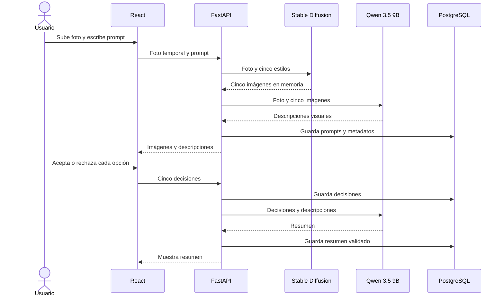

# Proyecto 2: plan de implementación para estilización de personas

> **Para agentes implementadores:** aplicar `superpowers:executing-plans` por entregable. Las casillas indican trabajo pendiente; este documento no afirma que el sistema esté implementado o probado.

**Objetivo:** recibir una foto de una persona real y un prompt, generar exactamente cinco imágenes estáticas con estilos de dibujo o animación, permitir aceptar o rechazar cada una y producir un resumen fiel de las decisiones.

**Arquitectura:** React + Vite presenta la interfaz; FastAPI coordina Stable Diffusion img2img y Qwen3.5-9B en la máquina con GPU. PostgreSQL conserva el historial textual por usuario. Las fotos y las imágenes generadas se manejan temporalmente en memoria y no se guardan en la aplicación.

**Stack:** React + Vite, FastAPI, PostgreSQL, Stable Diffusion, Diffusers, PyTorch y Qwen3.5-9B multimodal. La persona solicitante confirmó Qwen3.5-9B como variante para aclarar el nombre inicial «Qwen-3.5 VT 8B»; su [ficha oficial](https://huggingface.co/Qwen/Qwen3.5-9B) indica entrada de imagen y texto. Las versiones concretas de librerías y modelos se fijarán tras la prueba de compatibilidad.

**Fuentes del proyecto:** [enunciado](EvaluaciónProyecto2.pdf), secciones 2 a 5; [plan1.md](plan1.md); y la imagen de referencia proporcionada para los cinco estilos. El caso de uso, los tamaños de muestra, las tecnologías y el cronograma son decisiones del equipo.

## Alcance y criterios del enunciado

- La entrada es una fotografía cargada por el usuario, con una persona y su rostro visibles. Puede ser un retrato o una foto de cuerpo entero; se estiliza el vestuario que se vea en la entrada.
- La salida son **cinco imágenes estáticas**, no un video ni una animación en movimiento. Cada una representa un estilo diferente inspirado en la referencia adjunta.
- Conservar de forma reconocible rostro, apariencia, peinado, pose y ropa visible es un **objetivo a evaluar**, no una garantía del modelo.
- La interfaz presenta las cinco opciones y permite aceptar o rechazar cada una; una opción pendiente no equivale a rechazo.
- Qwen interpreta las imágenes y luego resume explícitamente las opciones aceptadas y rechazadas a partir de las decisiones registradas. La interpretación visual y los motivos expresados por el usuario son datos distintos.
- El enunciado exige seleccionar y justificar datos, realizar exploración y preprocesamiento, medir calidad visual, diversidad, coherencia y usabilidad, e incluir una reflexión ética.
- El producto incluye código reproducible, informe de máximo cinco páginas con elementos visuales y una demostración en vivo o video.
- No se almacenan imágenes de entrada ni de salida en PostgreSQL, en archivos de la aplicación, en registros ni en almacenamiento persistente del navegador. El historial es textual. Un dataset de investigación y los ejemplos autorizados para el informe se gestionan **fuera de la aplicación**, con permisos separados.

## Riesgos que deben cubrir las pruebas

1. Un modelo falla en la cuarta generación: el lote se marca fallido y no se muestran cuatro imágenes como si fueran cinco.
2. Un parser, servidor intermedio o registro escribe una imagen temporal: se rechaza la configuración y se corrige antes de la demo.
3. Dos usuarios usan el sistema: cada uno accede únicamente a su propio historial y sus decisiones.
4. Una decisión cambia después del resumen: el resumen anterior queda inválido; Qwen no puede inventar motivos ni invertir decisiones.
5. Una LoRA se intenta cargar en una base incompatible: el catálogo rechaza esa configuración e identifica el estilo afectado.

## Flujo del sistema

El diagrama muestra mensajes lógicos: la generación de los estilos y el análisis visual pueden ejecutarse de forma secuencial para administrar la GPU. [Fuente Mermaid](diagramas/plan2-flujo.mmd).




Al recargar o cerrar la página se pierden las imágenes temporales. El usuario puede consultar después prompts, configuraciones, descripciones y decisiones, pero no recuperar ni reproducir las imágenes desde el historial sin volver a cargar la foto. Guardar semillas y versiones ayuda a registrar la ejecución, pero por sí solo no permite reproducirla sin la entrada original ni asegura resultados idénticos en otro entorno.

## Cinco estilos y modelos candidatos

La imagen de referencia propone Ghibli, Disney, manga, cartoon y Kimetsu no Yaiba. Se usan como **nombres de referencia del experimento**, no como afiliación con los estudios o franquicias. Los enlaces siguientes se obtuvieron de la imagen adjunta; los tipos y familias indicados se consultaron en la API pública de Civitai el 27 de octubre de 2026. Son candidatos por validar, no una selección ya probada.

| ID | Tratamiento de referencia | Candidato y versión observada | Base observada |
| --- | --- | --- | --- |
| 1 | Ghibli | [Ghibli_style_mix](https://civitai.com/models/83071/ghiblistylemix), v1.0 / 88276: **checkpoint** | SD 1.5 |
| 2 | Disney | [Definitive Disney Studios](https://civitai.com/models/404277), versión Illustrious XL / 1355026: LoRA | Illustrious |
| 3 | Manga | [Manga style (anime sketch)](https://civitai.com/models/970066/manga-style-anime-sketch), V1 / 1086183: LoRA | SDXL 1.0 |
| 4 | Cartoon | [Cartoon style](https://civitai.com/models/45521/cartoon-style), v2.2 / 50148: LoRA | SD 1.5 |
| 5 | Kimetsu no Yaiba | [Demon Slayer / Kimetsu No Yaiba Anime Style LoRA](https://civitai.com/models/21272/demon-slayer-kimetsu-no-yaiba-anime-style-lora), offset / 25321: LoRA | SD 1.5 |

La versión Disney también anuncia variantes para otras familias; la tabla identifica una candidata concreta. **No se deben cargar estas cinco referencias sobre un único checkpoint por suposición**: Ghibli es un checkpoint completo y las LoRA restantes requieren una base y una versión compatibles. El entregable 1 debe elegir una base compatible para cada LoRA, verificar licencia, disponibilidad, formato y uso académico, y registrar versiones y permisos. Si una referencia no es utilizable, registrar el problema y proponer una alternativa para ese mismo tratamiento; no presentar la sustitución como validada sin probarla.

Propuesta técnica: partir de `img2img`, ajustar el prompt y `strength` por estilo y contrastar el resultado con la foto. La [documentación de Diffusers](https://huggingface.co/docs/diffusers/v0.22.3/en/using-diffusers/img2img) describe el efecto de `strength`; [ControlNet](https://huggingface.co/docs/diffusers/using-diffusers/controlnet) puede explorarse si la postura o composición se pierden, con pesos compatibles con la base correspondiente. No se promete preservación exacta. Para archivos de una sola pieza, Diffusers documenta [`from_single_file`](https://huggingface.co/docs/diffusers/api/loaders/single_file); las LoRA se cargan mediante los [adaptadores correspondientes](https://huggingface.co/docs/diffusers/api/loaders/lora).

La RTX A6000 indicada por el usuario cuenta con [48 GB de memoria gráfica](https://www.nvidia.com/en-us/products/workstations/rtx-a6000/). Antes de definir resolución, tiempos o carga simultánea, medir las cinco rutas y Qwen en esa máquina. Como punto de partida, generar una imagen a la vez y cargar o descargar modelos por familia; si no caben juntos, ejecutar generación y análisis visual en fases. La capacidad de la GPU no demuestra que se conserve la identidad ni garantiza que las cinco versiones sean compatibles.

## Investigación de datasets

El dataset se usa para exploración, ajuste de parámetros y evaluación. **No es necesario entrenar Stable Diffusion desde cero ni disponer de pares foto–ilustración para ejecutar img2img preentrenado.** La aplicación seguirá aceptando fotos del usuario fuera del conjunto de investigación.

| Dataset | Qué ofrece | Utilidad y límites para este caso |
| --- | --- | --- |
| [SHHQ](https://github.com/stylegan-human/StyleGAN-Human/blob/main/docs/Dataset.md) | 40 000 imágenes de personas de cuerpo completo; publica una **muestra de 100**. | Es la mejor candidata pública para estudiar pose y vestuario. Sus términos restringen el uso a investigación no comercial y prohíben redistribuir imágenes; revisar acceso y condiciones de la muestra antes de usarla. No trae cinco versiones estilizadas por persona. |
| [FFHQ](https://github.com/NVlabs/ffhq-dataset) | 70 000 fotografías centradas en rostros; metadatos de procedencia y licencia por imagen. | Sirve para explorar rostro y accesorios, pero los recortes no permiten evaluar bien el vestuario completo. El conjunto y sus imágenes tienen condiciones de uso y atribución que deben revisarse. |
| [face2comics](https://github.com/Sxela/face2comics) | 10 000 pares de rostros e ilustraciones de un estilo cómic, según su repositorio. | Referencia para explorar pares de rostro y dibujo; no cubre cinco estilos ni necesariamente cuerpo entero. Verificar procedencia y derechos de las imágenes antes de incorporarlas: la licencia del repositorio no sustituye esa revisión. |
| [Cartoon Set](https://google.github.io/cartoonset/) | Avatares 2D sintéticos con atributos, distribuidos en conjuntos de 10 000 y 100 000. | Útil como referencia de rasgos y diversidad de avatares; no contiene la foto real correspondiente ni evalúa preservación de una persona. Verificar términos del dataset por separado de los del código. |

**Recomendación:** evaluar primero la muestra de SHHQ como fuente pública, siempre que sus condiciones permitan el uso previsto. Complementarla, si el equipo puede obtener consentimiento, con un conjunto propio pequeño que represente las fotos que realmente aceptará la aplicación. No se encontró en las fuentes anteriores un conjunto listo que reúna fotos reales con sus cinco resultados exactos de referencia; no hace falta construir esos pares para la ruta preentrenada.

### Cómo preparar un conjunto propio pequeño

1. Invitar voluntarios adultos y explicar que se generarán imágenes estilizadas, quién tendrá acceso, cuánto tiempo se conservarán los datos de investigación y cómo solicitar retiro. Obtener permiso separado para mostrar fotos o resultados en el informe o la demo.
2. Meta propuesta: **30 fotos de 30 personas**, una por persona; asignar 10 personas a desarrollo y 20 diferentes a evaluación. Si no se alcanza, mínimo exploratorio de **15 personas**: 5 para desarrollo y 10 para evaluación. Informar el tamaño real y sus límites; no presentar los resultados como generalizables.
3. Pedir fotos con una sola persona, rostro visible y, cuando se quiera evaluar vestuario completo, cuerpo entero y ropa visible. Buscar variación voluntaria en iluminación, encuadre, pose y vestuario; no inferir ni registrar atributos sensibles de las personas.
4. Crear un manifiesto privado con `sample_id`, `person_id` seudónimo, origen, permiso de uso y fecha, permiso de divulgación separado, partición, dimensiones y observaciones de calidad. Mantener el vínculo con la persona y sus consentimientos por separado y con acceso restringido.
5. Dividir **por persona antes de ajustar prompts o parámetros**. Evitar que imágenes de una misma persona aparezcan en desarrollo y evaluación. Revisar formatos, orientación EXIF, resolución, duplicados, desenfoque y rostro o vestuario ocluidos; aplicar el mismo preprocesamiento reproducible.
6. Guardar el conjunto de investigación únicamente en una ubicación privada autorizada, fuera de PostgreSQL, del despliegue y de Git; restringir acceso y documentar la fecha de eliminación. Si no se autoriza conservar ninguna foto tampoco para investigación, usar una fuente accesible con condiciones comprobadas y documentar la limitación de reproducibilidad.

## Contrato de datos y persistencia

**En PostgreSQL:** usuarios, sesiones de generación, prompt escrito por el usuario y prompts efectivos de los cinco estilos, versiones y configuración del modelo, semillas, fecha, descripciones textuales de Qwen, decisiones y resumen. El texto también puede contener información personal: limitar el acceso al propietario y definir borrado del historial.

**Fuera de PostgreSQL y sin persistencia en la aplicación:** fotografía original, imágenes generadas, imágenes codificadas en Base64, máscaras, miniaturas, rutas o URL persistentes de imágenes y huellas faciales. El navegador conserva vistas solo en memoria mientras la página permanece abierta; el backend libera los bytes al concluir la solicitud o ante error. No registrar cuerpos de solicitudes o respuestas, configurar `Cache-Control: no-store` y evitar el almacenamiento temporal automático en disco, también en servidores intermedios. La caché de **pesos de modelos** es independiente y sí puede permanecer en disco.

Propuesta mínima de tablas:

- `users`: `id`, `username` único y `password_hash`; autenticación de sesión para asociar historial a una persona. No guardar contraseñas en texto plano.
- `generations`: `id`, `user_id`, `prompt_usuario`, `estado` (`generating`, `ready`, `failed`), identificador de Qwen, fecha y error resumido cuando corresponda.
- `variations`: `generation_id`, `position` de 1 a 5, `style`, `prompt_efectivo`, `negative_prompt`, `seed`, parámetros, identificadores y revisiones del checkpoint/LoRA y descripción visual de Qwen. Restricción única sobre `(generation_id, position)`.
- `decisions`: `(generation_id, position)`, estado `accepted` o `rejected`, motivo opcional y fecha. Ausencia de fila significa pendiente.
- `summaries`: `generation_id`, IDs aceptados, IDs rechazados, texto y revisión de decisiones. Cambiar una decisión invalida el resumen anterior.

Todos los accesos a una generación verifican su `user_id`. El estado `ready` solo se confirma cuando existen cinco resultados válidos con posiciones únicas del 1 al 5; una falla parcial se informa como falla, no como lote completo.

### API propuesta

| Operación | Contrato |
| --- | --- |
| `POST /api/auth/register`, `POST /api/auth/login`, `POST /api/auth/logout` | Crean el acceso y administran una sesión autenticada. La contraseña se guarda solo como hash; proteger la cookie de sesión y las peticiones que cambian estado. |
| `POST /api/generations` | Recibe sesión autenticada, imagen codificada, prompt y confirmación de consentimiento. Devuelve el ID y exactamente cinco posiciones con imagen temporal y descripción; si falla, devuelve un error recuperable. |
| `PUT /api/generations/{id}/decisions/{position}` | Guarda o actualiza `accepted`/`rejected` y motivo opcional. Invalida cualquier resumen anterior. |
| `POST /api/generations/{id}/summary` | Exige cinco decisiones; entrega a Qwen las decisiones y descripciones textuales, valida la partición de IDs y devuelve el resumen. No necesita recuperar imágenes. |
| `GET /api/generations` y `GET /api/generations/{id}` | Devuelven únicamente historial textual del usuario autenticado; nunca imágenes. |

Para evitar la escritura implícita de archivos temporales por el procesamiento multipart, el prototipo puede usar una solicitud JSON con imagen Base64 en memoria, con un límite de cuerpo aplicado **antes de leerlo**. Límite inicial propuesto: imagen decodificada de 10 MB y 20 megapíxeles como máximo, con margen para la codificación en el límite del cuerpo. Validar contenido real, no solo extensión; aceptar JPEG, PNG y WebP. Controlar solicitudes concurrentes mediante una cola o exclusión de GPU, sin dejar el proceso sin memoria.

### Función de Qwen

1. Con las imágenes aún en memoria, comparar la foto de entrada con cada resultado y generar una descripción breve de rasgos visibles, ropa y tratamiento visual, identificada por posición. Procesar pares secuencialmente si la memoria lo requiere.
2. Tratar el texto de imágenes y motivos como datos, no como instrucciones. No identificar a la persona, inferir atributos sensibles ni asegurar rasgos que no sean visibles. Marcar las observaciones inciertas; revisarlas mediante evaluación humana.
3. Tras las cinco decisiones, resumir desde los registros estructurados y las descripciones. Una observación de Qwen no es un motivo del usuario: si no se ingresó un motivo, no atribuirlo.
4. Exigir JSON con `accepted_ids`, `rejected_ids` y `summary`; validar que los IDs formen una partición completa y coincidan con PostgreSQL. Si la respuesta es inválida, reintentar una vez y luego mostrar error sin perder las decisiones. La validación de listas no demuestra por sí sola que el texto sea fiel: revisar el texto completo durante la evaluación.

## Organización propuesta

```text
frontend/                    # React + Vite: carga, galería, decisiones e historial
backend/app/main.py          # API FastAPI y ciclo de vida
backend/app/auth.py          # Acceso y aislamiento por usuario
backend/app/models.py        # Esquema de PostgreSQL
backend/app/schemas.py       # Contratos de entrada y salida
backend/app/generation.py    # Rutas img2img y catálogo de estilos
backend/app/vision.py        # Interpretación visual y resumen con Qwen
backend/app/storage.py       # Transacciones e historial textual
backend/tests/               # Pruebas de contratos e integración
data/manifest.example.csv    # Esquema del manifiesto, sin datos personales
notebooks/01_data.ipynb      # Exploración del conjunto autorizado
scripts/evaluate.py          # Métricas agregadas sin guardar imágenes de app
report/informe.md            # Informe del equipo
README.md                    # Instalación, pesos, ejecución y limitaciones
```

Son rutas propuestas; los archivos de datos reales, pesos, credenciales y fotografías se conservan fuera de Git. Usar migraciones para el esquema y registrar versiones resueltas de frontend, backend, CUDA, modelos y dependencias tras comprobarlas.

## Entregables y cronograma propuesto

Referencia de **diez días para cinco integrantes**; ajustar al plazo real. Cada entregable tiene una persona responsable de coordinarlo, con colaboración del resto del equipo y evidencia para su criterio de cierre.

### Entregable 1: factibilidad y selección de modelos — día 1

**Alcance:** determinar si las cinco rutas candidatas y Qwen funcionan en la A6000 antes de desarrollar el flujo completo.

- [ ] Verificar GPU, controlador, versión compatible de PyTorch/CUDA y espacio de almacenamiento para pesos. Descargar solo modelos autorizados y registrar fuente, versión, licencia y condiciones.
- [ ] Para cada fila de estilos, identificar base, checkpoint y LoRA compatibles; comprobar que Diffusers pueda cargarlos. Registrar la versión exacta y los prompts iniciales. Si falta un recurso o autorización, documentar una alternativa y su condición de validación.
- [ ] Con una foto autorizada, generar un resultado por ruta y comparar rostro, pose, ropa, estilo, artefactos, latencia y pico de memoria. Probar Qwen3.5-9B con la foto y una salida; comprobar JSON y calidad de la descripción.
- [ ] Medir si ambos modelos caben juntos; elegir carga simultánea o por fases según evidencia. Elegir tamaños y parámetros iniciales por familia y registrar resultados, incluidos fallos.

**Cierre:** cinco rutas con fuentes y compatibilidad verificadas, más una ejecución real de Qwen; parámetros y recursos medidos. Si alguna ruta falla, el plan sigue bloqueado para esa ruta hasta resolverla, sin fingir que las cinco están listas. Evidencia para diseño y modelo generativo: 8 puntos.

### Entregable 2: dataset y análisis exploratorio — días 2 y 3

**Alcance:** seleccionar la fuente pública o propia y preparar una muestra trazable para desarrollo y evaluación.

- [ ] Revisar acceso y permisos de SHHQ y, si se utiliza, su muestra de 100; decidir si se complementa con fotografías propias consentidas. Registrar la justificación y las restricciones de cada fuente.
- [ ] Preparar los subconjuntos descritos arriba y el manifiesto privado. Confirmar separación por persona, sin imágenes reales en Git o en el sistema de historial.
- [ ] En `notebooks/01_data.ipynb`, documentar cantidad de imágenes y personas, dimensiones, formato, pose, encuadre, visibilidad de rostro y vestuario, duplicados y limitaciones de la muestra. No inferir atributos sensibles.
- [ ] Implementar preprocesamiento reproducible: validar formato y tamaño, corregir orientación, convertir a RGB y ajustar la resolución a cada base conservando proporciones. Registrar cuándo se rellena o recorta la imagen.

**Cierre:** fuente autorizada, manifiesto y análisis disponibles; particiones por persona documentadas y entrada propia del usuario habilitada.

### Entregable 3: generador img2img — días 3 a 5

**Archivos:** `backend/app/generation.py`, `backend/tests/test_generation.py`.

- [ ] Definir `generate_five(image, user_prompt) -> list[VariationResult]`: cada resultado contiene posición, estilo, bytes de imagen en memoria, prompt efectivo, semilla, parámetros y versión de modelo.
- [ ] Implementar el catálogo de cinco rutas y el intercambio de checkpoints/LoRA por familia; reutilizar o liberar modelos según la medición de GPU. Producir las cinco opciones de forma secuencial inicialmente.
- [ ] En las imágenes de desarrollo, comparar al menos dos valores de `strength` por familia; conservar el resto de parámetros para interpretar la comparación. Registrar calidad, preservación, diversidad, tiempo y memoria; seleccionar parámetros antes de evaluar el conjunto reservado.
- [ ] Probar con dobles que se rechacen lotes con menos de cinco resultados, IDs repetidos, imágenes inválidas o LoRA incompatibles, y que un error libere la memoria. Probar aparte una ejecución **real** con los cinco modelos y la A6000.

**Cierre:** cinco imágenes reales distintas por entrada, una por tratamiento, y parámetros documentados. La calidad de preservación se reporta con evidencia, no se supone. Evidencia para modelo generativo: 4 puntos.

### Entregable 4: API, usuarios e historial — días 4 a 6

**Archivos:** `backend/app/main.py`, `auth.py`, `models.py`, `schemas.py`, `storage.py`, migraciones y pruebas de API.

- [ ] Crear PostgreSQL y las tablas propuestas; registrar usuarios y sesiones de acceso con contraseñas protegidas mediante una librería de hashing de contraseñas. Proteger cada consulta por propietario.
- [ ] Implementar los endpoints de generación, decisión, resumen e historial con los contratos anteriores; guardar prompts efectivos y estados mediante transacciones. Si un resultado falla, marcar la ejecución como fallida y no mostrarla como lote completo.
- [ ] Aplicar límites de tamaño antes de cargar el cuerpo, control de concurrencia de GPU y mensajes claros para imagen inválida, tiempo de espera o modelo no disponible. Evitar persistencia y registros de imágenes durante procesamiento, incluso mediante archivos temporales de carga.
- [ ] Probar que otro usuario no pueda leer ni modificar una sesión, que el historial carezca de bytes/Base64/rutas de imagen y que no haya archivos de imagen de aplicación tras éxito o error. Probar que una decisión modificada invalide el resumen.

**Cierre:** API y esquema reproducibles; historial textual aislado por usuario e imágenes temporales. Evidencia para integración y registro: 4 puntos.

### Entregable 5: interfaz React + Vite — días 5 a 7

**Archivos:** `frontend/src/` y pruebas de interfaz.

- [ ] Crear acceso de usuario, carga de foto, prompt y consentimiento para procesar la imagen. Mostrar estado de generación y errores recuperables.
- [ ] Presentar original y cinco opciones numeradas en una galería adaptable; ofrecer aceptar o rechazar cada una y un motivo opcional. Iniciar las opciones sin decisión.
- [ ] Conservar las vistas únicamente en memoria de la página y limpiar referencias al cambiar la foto, cerrar sesión o abandonar la página. Advertir que una recarga elimina las vistas; el historial seguirá siendo textual.
- [ ] Deshabilitar el resumen mientras falte una decisión y limpiar la galería y selección al iniciar otra generación. Mostrar el resumen validado y el historial propio.
- [ ] Verificar carga inválida, respuesta parcial, nueva foto, decisiones pendientes y recarga; completar un recorrido con la API real.

**Cierre:** una persona puede completar el flujo sin que se mezclen sesiones ni se persistan imágenes. Evidencia para interacción humano–IA: 4 puntos.

### Entregable 6: Qwen, decisiones y evaluación — días 7 a 9

**Archivos:** `backend/app/vision.py`, `backend/tests/test_vision.py`, `scripts/evaluate.py`.

- [ ] Implementar `describe_variation(original, generated, position) -> str` con Qwen3.5-9B y `summarize_decisions(descriptions, decisions) -> Summary`. Ejecutar el análisis mientras las imágenes están en memoria.
- [ ] Probar las 32 combinaciones de aceptación/rechazo de cinco opciones con respuestas controladas; cubrir ID omitido o duplicado, motivo ausente, JSON inválido y fallo del modelo. Probar Qwen real y revisar el texto completo para detectar contradicciones o motivos inventados.
- [ ] Generar cinco variaciones para cada imagen reservada: **100 resultados** con 20 fotos o **50** si se usa el mínimo de 10. Congelar parámetros antes de esta evaluación. Guardar métricas agregadas y textos sin guardar las imágenes desde la aplicación.
- [ ] Evaluar visualmente cada par foto–resultado durante la sesión: preservación del rostro, del vestuario y de la pose, fidelidad al estilo y artefactos en escalas separadas de 1 a 5. Registrar denominadores, promedio, dispersión y ejemplos de fallos. La valoración humana es subjetiva y no prueba identidad biométrica.
- [ ] Medir diversidad útil dentro de cada lote y, si hay evaluadores disponibles, pedir que identifiquen el estilo sin revelar su etiqueta; reportar aciertos y confusiones sin asumir que las etiquetas son una verdad objetiva. Probar usabilidad con cinco voluntarios en tres sesiones cada uno, si es posible, e informar el número real.
- [ ] Medir proporción de decisiones descritas correctamente, resúmenes sin contradicciones, tiempo de generación y de explicación, fallos y pico de VRAM. Conservar resultados negativos y limitaciones.

**Cierre:** evaluación real de generación, explicación y usabilidad con su tamaño de muestra; no se confunden pruebas simuladas con resultados del modelo. Evidencia para explicabilidad y evaluación: 6 puntos.

### Entregable 7: informe, reproducción y demostración — día 10

**Archivos:** `README.md`, `report/informe.md`, informe PDF y video solo si se elige esa modalidad.

- [ ] Documentar instalación de frontend, backend, PostgreSQL, controladores, pesos y configuración; incluir comandos, versiones, requisitos de memoria y procedimiento para ejecutar en la A6000.
- [ ] Preparar un informe de máximo cinco páginas: problema y arquitectura; datos y modelo; interfaz y decisiones; resultados y ejemplos; limitaciones, ética y referencias. Incluir el diagrama legible y resultados reales.
- [ ] Para los ejemplos visuales del informe o una grabación, usar únicamente imágenes de participantes con permiso específico para divulgación. Estos materiales de investigación se manejan por separado; no habilitan el guardado de imágenes en la aplicación.
- [ ] Tratar consentimiento, retención, acceso al historial, sesgos en representaciones, alteración de identidad, licencias de datasets/checkpoints/LoRA y derechos asociados a personajes o estilos de referencia.
- [ ] Ensayar una demostración completa: cargar foto autorizada, generar cinco estilos, decidir las cinco opciones y mostrar el resumen y el historial textual. Verificar que imágenes no queden persistidas por la aplicación.

**Cierre:** entrega reproducible, informe y demo acordes con el enunciado. Evidencia para ética y documentación: 2 puntos.

## Reparto sugerido

| Integrante | Responsabilidad principal | Colaboración |
| --- | --- | --- |
| A | Stable Diffusion, Diffusers, rutas img2img y GPU | Compatibilidad de modelos con D; evaluación visual con E |
| B | React + Vite, galería y experiencia de usuario | Pruebas de usabilidad con E; integración de flujo con C |
| C | FastAPI, PostgreSQL, autenticación e historial | Privacidad y contratos de API con B; integración con A y D |
| D | Qwen3.5-9B, análisis visual y resumen de decisiones | Contratos de salida con C; validación de explicaciones con E |
| E | Dataset, manifiesto, análisis exploratorio y evaluación | Criterios de preservación con A; usabilidad con B; métricas y reporte con D |

Las responsabilidades indican quién coordina cada área, no trabajo aislado: el equipo revisa los contratos entre componentes, integra el sistema y comparte la revisión del informe y la demostración. E coordina la evaluación; las calificaciones visuales y conclusiones se revisan en conjunto para mantener criterios consistentes.

## Decisiones y límites pendientes

- Verificar acceso, licencias, versiones y compatibilidad real de las cinco referencias y sus bases; seleccionar alternativas si alguna falla.
- Medir calidad y memoria de las cinco rutas con Qwen3.5-9B en la A6000; la carga simultánea y los tiempos no están demostrados.
- Confirmar fuente autorizada del dataset, disponibilidad de voluntarios y permisos de divulgación para el informe.
- Ajustar los diez días al plazo real y fijar la política de retención y eliminación del historial textual.
- Este plan no implementa el sistema, no descarga modelos ni datasets y no acredita calidad visual hasta ejecutar las pruebas previstas.
